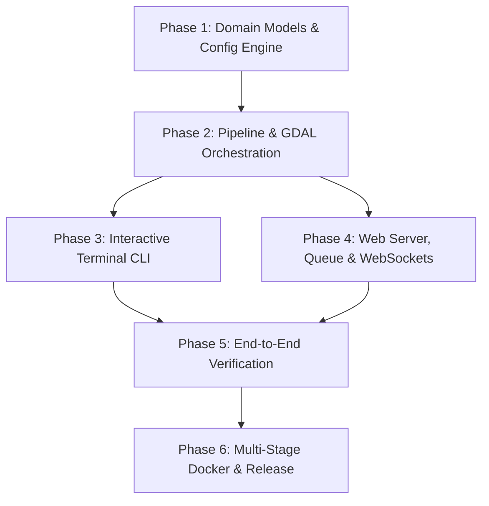

# Implementation Plan: Converting Chartmaker to Rust (v4)

This document provides a comprehensive technical architecture and execution roadmap for converting the **Chartmaker** aeronautical raster chart generation system from Node.js to the **Rust** programming language.

---

## 1. Executive Summary

**Chartmaker** is an FAA aeronautical chart raster processor that downloads digital GeoTIFF charts, clips them using shapefile cutlines, reprojects them into Web Mercator (`EPSG:3857`), merges multi-tile regions, and creates optimized SQLite `.mbtiles` raster pyramids with Lanczos overviews.

It currently runs as a hybrid Node.js application (`make.js`, ~1,740 lines) featuring:
1. **Interactive Terminal CLI Loop**: A multi-tiered terminal menu for manual chart builds.
2. **Web Service Mode**: An Express HTTP + WebSocket server serving a Vite-built SPA, orchestrating an asynchronous multi-user job queue with cancellation and real-time progress streaming.
3. **Geospatial Pipeline Engine**: Subprocess orchestration of GDAL command-line utilities (`gdalwarp`, `gdal_translate`, `gdalbuildvrt`, `gdaladdo`) and SQLite metadata tagging.

### Why Convert to Rust?
- **Resource Footprint**: Drops memory consumption from ~150–250MB (Node.js runtime + V8 heap) to <25MB (Rust native binary).
- **Deployment Simplicity**: A single self-contained native binary. In Docker, Node.js and `npm` are eliminated entirely from the production runtime image; only the compiled binary and the GDAL CLI/runtime libraries are needed.
- **Robust Concurrency & Type Safety**: Compile-time guarantees for the job queue, cancellation tokens (`tokio_util`), thread-safe WebSocket broadcasting, and strongly-typed configuration/API message models.
- **Direct SQLite Manipulation**: Replaces external shell-outs to the `sqlite3` CLI with embedded in-process `rusqlite` transactions, eliminating shell escaping hazards and improving metadata write speed.
- **100% Frontend Compatibility**: The existing Vite/HTML/CSS frontend (`dist/`) requires **zero code changes**—the Rust web server serves identical static assets, REST endpoints, and WebSocket JSON message protocols (`AppMessage`).

---

## 2. Component Mapping: Node.js vs. Rust

| Subsystem / Functionality | Node.js Implementation (`make.js`) | Recommended Rust Equivalent | Rationale / Benefits |
| :--- | :--- | :--- | :--- |
| **Async Runtime & Concurrency** | Node.js Event Loop, `setTimeout`, `AbortController` | **`tokio`** (multi-threaded), **`tokio_util::sync::CancellationToken`** | Native OS thread pool for I/O; clean cooperative cancellation without race conditions. |
| **Web Server & Routing** | `express` 5.x | **`axum`** 0.7 + **`tower`** / **`tower-http`** | High performance, memory-efficient, ergonomic async HTTP framework built on Tokio. |
| **Static File Serving** | `express.static('dist')` | **`tower-http::services::ServeDir`** | Native static file streaming with caching headers and fallback to `index.html`. |
| **WebSocket Engine** | `ws` (`WebSocketServer`) on shared HTTP port | **`axum::extract::ws`** | First-class unified WebSocket handling on the exact same HTTP port. |
| **Authentication** | Custom Express middleware + Base64 check against `users.json` | **`axum-auth`** or custom `tower::Layer` checking `users.json` | Strongly typed basic auth middleware with constant-time equality checks. |
| **User Identity & Cookies** | Custom cookie parser for `chartmaker_uid` | **`tower-cookies`** | Safe cookie extraction and injection. |
| **Terminal CLI Menus** | `readline-sync` | **`inquire`** or **`dialoguer`** | Full terminal PTY support, arrow key navigation, text search, and clean "Start over" handling. |
| **Configuration & Dates** | `js-yaml`, `JSON.parse`, `new Date()` | **`serde`**, **`serde_yaml`**, **`serde_json`**, **`chrono`** | Compile-time validated schemas for `config.yml`, `chartdates.json`, and cycle calculations. |
| **HTTP Chart Downloader** | `execSync('curl ...')` / `fetch` | **`reqwest`** (streaming async) | Native async HTTP downloads directly to disk with live byte progress tracking. |
| **Archive Operations** | Shell `unzip`, shell `zip -j -1` | **`zip`** crate or `tokio::process::Command` | In-process streaming zip manipulation, or subprocess execution for multi-GB archives. |
| **GDAL Pipeline** | Child process shell-outs (`execCommandAsync`) | **`tokio::process::Command`** (Option A) | Highest stability, identical CLI flags, zero C++ FFI crashing risk, isolated process memory. |
| **MBTILES Metadata** | Shell out to `sqlite3 ${mbtiles} "..."` | **`rusqlite`** (in-process SQLite) | Safe parameterized SQL, no process spawns, transactional integrity. |

---

## 3. GDAL Integration Architecture: Subprocess vs. C-FFI

A critical architectural decision when writing Rust geospatial tools is how to interface with GDAL:

```
┌────────────────────────────────────────────────────────────────────────┐
│                        Rust Application Core                           │
│     (Axum Web Server, Tokio Job Queue, Inquire CLI, Serde Config)      │
└──────────────────┬─────────────────────────────────┬───────────────────┘
                   │                                 │
         Option A: Subprocess Execution     Option B: C++ FFI (gdal-rs)
                   │                                 │
        ┌──────────┴──────────┐            ┌─────────┴─────────┐
        │ tokio::process::Cmd │            │ C++ Shared Libs   │
        │ gdalwarp, gdaladdo, │            │ In-memory Driver  │
        │ gdal_translate      │            │ C API Bindings    │
        └──────────┬──────────┘            └─────────┬─────────┘
                   │                                 │
                   └────────────────┬────────────────┘
                                    ▼
                         Target MBTILES Database
                                    ▲
                                    │ (Direct in-process SQL)
                             rusqlite Crate
```

### Evaluation
1. **Option A: Subprocess Orchestration (Recommended)**:
   - Run `gdalinfo`, `gdal_translate`, `gdalwarp`, `gdalbuildvrt`, and `gdaladdo` via `tokio::process::Command`.
   - **Pros**: 100% bug-for-bug compatibility with current flags (`-co ZOOM_LEVEL_STRATEGY=UPPER`, `-r lanczos`, cutlines with `-cwhere`, memory config flags); process isolation prevents memory leaks or C++ driver crashes from taking down the web server; straightforward compilation without complex C++ header link errors.
   - **Cons**: Minor overhead of spawning child processes (negligible given raster operations take seconds to minutes).
2. **Option B: Native Rust `gdal` Crate (FFI)**:
   - Call the C GDAL API directly in-process.
   - **Pros**: Single monolithic binary; programmatic dataset manipulation.
   - **Cons**: High build complexity (requires exact matching `libgdal-dev` version); multi-threading with GDAL raster drivers requires complex mutex locking; overview generation (`gdaladdo`) and multi-layer cutline warping are notoriously fragile through FFI bindings.

> [!TIP]
> **Design Decision**: Use **Option A** (`tokio::process::Command`) for raster transformations combined with **`rusqlite`** for in-process MBTILES metadata updates. This yields maximum stability, simplicity, and safety.

---

## 4. Proposed Rust Project Layout

```
chartmaker-rs/
├── Cargo.toml
├── build.rs                        // Optional: embed git hash / build metadata
├── src/
│   ├── main.rs                     // Entrypoint: CLI loop vs Webserver mode selector
│   ├── config.rs                   // Serde structs for config.yml
│   ├── models/
│   │   ├── mod.rs
│   │   ├── app_message.rs          // Strongly-typed AppMessage enum & JSON serialization
│   │   ├── chart.rs                // ChartTaskContext, FullChart, AreaChart structs
│   │   └── date.rs                 // FAA cycle date calculation (parseChartDateString, getBestChartDate)
│   ├── pipeline/
│   │   ├── mod.rs
│   │   ├── downloader.rs           // Reqwest chart download, cache cycle management & purging
│   │   ├── unzip.rs                // Archive extraction into workarea
│   │   ├── normalizer.rs           // Filename cleanup & GDAL band inspection
│   │   ├── gdal.rs                 // GDAL orchestration (gdalwarp, gdal_translate, gdaladdo)
│   │   └── mbtiles.rs              // Rusqlite metadata updates & attribution insertion
│   ├── queue/
│   │   ├── mod.rs
│   │   └── job_queue.rs            // Multi-user FIFO queue with CancellationToken support
│   ├── server/
│   │   ├── mod.rs
│   │   ├── app.rs                  // Axum router, static file serving (dist/), CORS/headers
│   │   ├── auth.rs                 // HTTP Basic auth middleware (users.json)
│   │   ├── handlers.rs             // REST endpoints (/status, /make, /download, /cancel, etc.)
│   │   └── ws.rs                   // WebSocket connection registry & broadcast channels
│   └── cli/
│       ├── mod.rs
│       └── menu.rs                 // Interactive terminal menu loop & "Start over" navigation
```

---

## 5. Core Implementation Details

### 5.1 Strong Typing for Configuration & Messages
In Rust, `config.yml` and WebSocket messages are strongly typed with `serde`:

```rust
#[derive(Debug, Clone, Deserialize, Serialize)]
pub struct Configuration {
    pub attribution: String,
    pub vfrdownloadtemplate: String,
    pub vfrindividualtemplate: String,
    pub ifrdownloadtemplate: String,
    pub tileimagequality: u8,
    pub outputgrayscale: bool,
    pub httpport: u16,
    pub pinginterval: u64,
    pub useauthentication: bool,
    pub downloadzipfilename: String,
    pub fullchartlist: Vec<[String; 3]>,
    pub areachartlist: Vec<String>,
    // Optional overrides
    pub webservermode: Option<bool>,
}

#[derive(Debug, Clone, Serialize, Deserialize)]
#[serde(tag = "type", rename_all = "lowercase")]
pub enum AppMessage {
    Info { payload: String, uid: String },
    Running { rowindex: i32, filename: String, dbfilename: String, uid: String },
    Complete { rowindex: i32, filename: String, dbfilename: String, payload: String, uid: String },
    CommandResponse { payload: String, uid: String, items: Option<Vec<QueueItemInfo>> },
    SyncState { payload: UserJobState, uid: String },
    Timing { payload: String, uid: String },
    Download { dbfilename: Option<String>, rowindex: Option<i32>, completed: bool, uid: String },
}
```

### 5.2 Concurrency & Cancellation
In Node.js, `AbortController` signals child processes to kill them. In Rust, we use `tokio_util::sync::CancellationToken`:

```rust
pub struct MakeJob {
    pub job_id: String,
    pub uid: String,
    pub command_list: Vec<CommandItem>,
    pub cancel_token: CancellationToken,
    // ...
}

// In pipeline execution:
tokio::select! {
    _ = cancel_token.cancelled() => {
        // Kill running child process
        child.kill().await?;
        // Cleanup workarea directory
        tokio::fs::remove_dir_all(&chart_folder).await?;
        return Err(PipelineError::Cancelled);
    }
    result = child.wait() => {
        // Process next stage
    }
}
```

### 5.3 Embedded SQLite MBTILES Tagging
Instead of spawning `sqlite3`, Rust uses `rusqlite` for instant, safe metadata insertion:

```rust
pub fn update_mbtiles_metadata(mbtiles_path: &Path, meta_desc: &str, attribution: &str) -> Result<()> {
    let conn = Connection::open(mbtiles_path)?;
    conn.execute(
        "UPDATE metadata SET value = ?1 WHERE name IN ('name', 'description')",
        params![meta_desc],
    )?;
    conn.execute(
        "INSERT OR REPLACE INTO metadata (name, value) VALUES ('attribution', ?1)",
        params![attribution],
    )?;
    Ok(())
}
```

---

## 6. Phased Migration Roadmap



### Phase 1: Domain Models & Config Engine (Days 1–3)
- Implement `config.rs` reading and validating `config.yml`.
- Implement `models/date.rs` parsing `chartdates.json`, implementing `parseChartDateString` and `getBestChartDate()` with `chrono`.
- Implement cache inspection and cycle expiration logic (deleting older `.zip` files when a newer cycle is detected).
- Unit tests for date comparisons and cycle resolution.

### Phase 2: Pipeline & GDAL Orchestration (Days 4–7)
- Build async child process executor with stdout/stderr line streaming and cancellation.
- Port `normalizeFileName` and `buildChartNameArray`.
- Port `gdalinfo -json` band length checks (`bands.len() == 1` -> `-expand rgb` or `-expand gray`).
- Port cutline warping (`gdalwarp -t_srs EPSG:3857 ... -cutline ... -crop_to_cutline`).
- Port `gdalbuildvrt`, `gdal_translate -of MBTILES`, and `gdaladdo` with Lanczos resampling.
- Port metadata and attribution tagging using `rusqlite`.
- Verification: Run a test build of a single sectional area and compare the resulting `.mbtiles` against Node.js output.

### Phase 3: Interactive Terminal CLI Mode (Days 8–9)
- Implement `cli/menu.rs` using `inquire`.
- Main menu loop: Area charts, Full charts, All areas, All fulls, Download missing, Exit.
- Sub-menus with dynamic items and the "Start over" option returning cleanly to the root menu.
- Terminal log streaming and duration reporting (`HH:MM:SS`).

### Phase 4: Web Server, Job Queue & WebSockets (Days 10–14)
- Implement `JobQueue` actor in Tokio with FIFO channel, user job tracking (`Map<String, JobState>`), and cancellation.
- Implement Axum router:
  - Serve static `dist/` with `ServeDir` and SPA fallback.
  - REST endpoints: `/status`, `/job-state`, `/clearjob`, `/existingcount`, `/sendexisting`, `/make`, `/cancel`, `/download`.
  - HTTP Basic auth middleware checking `users.json`.
  - WebSocket upgrade route (`/`) handling client connections, ping/pong heartbeats, and progress broadcasts.
- Implement multi-file ZIP archive creation for chart downloads (`/download`).

### Phase 5: Verification & Parity Testing (Days 15–17)
- Point existing Vite web client (`dist/`) at the Rust server:
  - Verify chart queueing, position tracking, and multi-user isolation.
  - Verify real-time row progress indicators (`AppMessage::Running`, `AppMessage::Complete`).
  - Verify job cancellation during `gdalwarp` and cleanup of `./workarea`.
  - Verify download of generated `.mbtiles` archives.
- Point CLI at terminal: verify identical interactive workflows.

### Phase 6: Multi-Stage Docker Containerization (Days 18–20)
- Author multi-stage Dockerfile:
  - **Stage 1 (Node)**: Build web client assets (`npm run build`).
  - **Stage 2 (Rust / Cargo)**: Compile optimized release binary with `cargo build --release`.
  - **Stage 3 (Runtime)**: Minimal Ubuntu base with GDAL runtime packages (`gdal-bin`, `libgdal-dev`, `ca-certificates`, `sqlite3`), copying the compiled binary and `dist/`.
- Update `docker-compose.yml` to run the Rust binary directly without Node.js.

---

## 7. Multi-Stage Dockerfile Architecture

The new Docker build completely eliminates Node.js from the production image:

```dockerfile
# -----------------------------------------------------------------
# Stage 1: Build the Web UI assets
# -----------------------------------------------------------------
FROM node:20-alpine AS frontend-builder
WORKDIR /build
COPY package*.json vite.config.js ./
RUN npm ci
COPY src/ ./src/
COPY public/ ./public/
COPY index.html ./
RUN npm run build

# -----------------------------------------------------------------
# Stage 2: Compile the Rust application
# -----------------------------------------------------------------
FROM rust:1.82-bookworm AS backend-builder
WORKDIR /build
COPY Cargo.toml Cargo.lock ./
# Pre-fetch and cache dependencies
RUN mkdir src && echo "fn main() {}" > src/main.rs && cargo build --release && rm -rf src
COPY src/ ./src/
RUN touch src/main.rs && cargo build --release

# -----------------------------------------------------------------
# Stage 3: Minimal Production Runtime
# -----------------------------------------------------------------
FROM ghcr.io/osgeo/gdal:ubuntu-small-latest
RUN apt-get update && apt-get install -y --no-install-recommends \
    curl \
    unzip \
    zip \
    sqlite3 \
    ca-certificates \
    && rm -rf /var/lib/apt/lists/*

WORKDIR /chartmaker
COPY --from=backend-builder /build/target/release/chartmaker-rs ./chartmaker
COPY --from=frontend-builder /build/dist ./dist
COPY config.yml chartdates.json users.json ./
COPY clipshapes/ ./clipshapes/

RUN mkdir -p /chartmaker/chartcache /chartmaker/mbtiles /chartmaker/workarea \
    && chmod -R 777 /chartmaker

EXPOSE 8500
ENV WEBSERVER=true
CMD ["./chartmaker"]
```

---

## 8. Effort & Feasibility Assessment

- **Overall Feasibility**: **Very High**. Chartmaker is well-structured, modular, and does not rely on proprietary Node-only libraries. The web frontend communicates exclusively over clean HTTP/JSON and WebSockets.
- **Estimated Development Effort**:
  - **Solo Developer**: ~3 to 4 weeks (15–20 working days).
  - **With Antigravity Assistance**: ~4 to 7 working days, implementing module-by-module with parallel automated test verification.
- **Key Risks & Mitigations**:
  - *Risk*: Child process piping and kill propagation across OS boundaries.
    *Mitigation*: Use process group signals (`nix::sys::signal` on Unix) to ensure `gdalwarp` child processes terminate cleanly when a job is cancelled.
  - *Risk*: WebSocket protocol regressions breaking the web frontend.
    *Mitigation*: Write integration tests replicating exact JSON payloads sent and received by `src/js/app.js`.

---

## 9. Next Steps & Decision Points

1. **Architecture Confirmation**: Approve the subprocess orchestration model (Option A) + `rusqlite` for database tagging.
2. **Repository Strategy**: Decide whether to:
   - Create a side-by-side directory (e.g. `chartmaker-rs/` or `crates/chartmaker/`) within this repository, OR
   - Create a dedicated Git branch (`feat/rust-port`) to transition in-place.
3. **Execution**: Proceed to Phase 1 (Data models, Serde configuration, and cycle date calculations).
